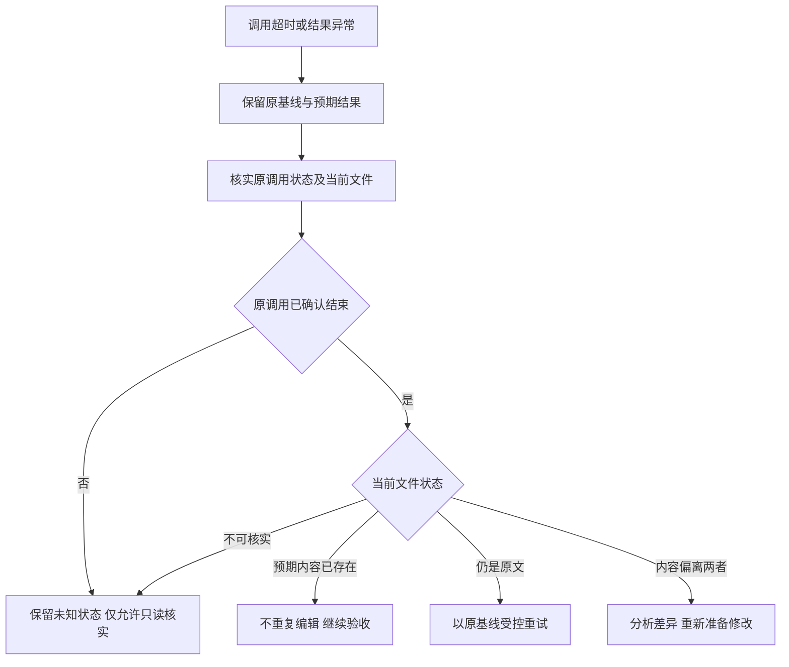

# 中断后的核实与恢复

> SPEC《2026-09-29 agent-fs 可靠编辑》§7 的落地细则。适用场景：编辑工具调用
> 超时、连接中断、响应缺失，或 CLI 返回退出码 3（`status=unknown`）。

## 核心原则

1. **调用异常不证明"没有修改文件"**（不变量 4）。
2. 原调用尚未结束或无法确认结束时，**不启动同一目标的替代写入**（不变量 5）。
3. 重新读取不会自动授权覆盖、删除或回滚其他人的修改（不变量 6）。
4. 无法证明的状态显式保留未知，不用笼统 `retryable=true` 替代判断（不变量 8）。

## 断线场景分流

- **编辑工具不可用、终端仍可用**：先确认原调用状态，再经本地 CLI 核实文件；
  符合恢复条件时切换受控写入。
- **调用超时或响应缺失**：调用方记录结果未知。即使终端立即可用，
  也**不得同时启动第二个写入者**。
- **所有执行通道均不可用**：暂停依赖该结果的修改，保留已有恢复信息；
  通道恢复后先读取当前磁盘状态。
- **目标位于不可达的网络盘**：reconcile 返回 `unavailable`，不把本地缓存或
  "文件不存在"自动解释成空文件。
- **会话重启且恢复信息遗失**：重新读取并分析现状，不能根据历史对话猜测已执行
  步骤（自动续做属于第二阶段）。

## 原调用状态优先于重试

从宿主获取原调用状态，只有以下证据算**已结束**：

- 已退出的进程；
- 明确的请求完成回执（`finished`）；
- 取消且执行端确认停止（`cancelled_and_stopped`）。

以下**均不充分**：超时、取消请求已发送、PID 不可查询、当前协作锁恰好可获取。

- 原调用为 `running`：等待完成或按已有授权取消。
- 原调用为 `unknown`：可以继续**只读核实**（reconcile），但不得启动替代写入；
  即使核实发现 `desired_present`，也要说明原调用仍未确认结束，不得启动依赖
  该文件稳定结果的后续写入。

## 恢复决策流程

- **desired_present**：预期结果当前已存在——禁止重复应用，继续内容验收。
  （"恢复成功"只表示当前内容满足本次编辑预期；不能推断该内容一定由本次
  请求写入，也不能推断历史上只执行过一次。）
- **base_present**：当前仍是原文——原调用结束后允许恢复性重试，但须保留
  原 Hbase 和原 Htarget，重新检查修改材料；重试时命令仍做完整并发校验，
  核实与写入之间发生新修改会被拒绝。
- **重试上限**：对同一份准备材料，默认**最多一次**恢复性重试。再次中断或
  冲突后停止自动写入，保留上下文并说明当前状态；没有新的证据或修订后的
  修改方案，不继续循环。用户后来明确要求继续时，仍从核实状态开始。
- **diverged**：读取最新完整内容，分析是否部分实现了原意。重新生成补丁属于
  新的编辑尝试，**必须保留他人改动**，不能只更换 expected_sha256；逐项识别
  已生效编辑，避免重复追加。
- **unavailable**：目标消失、不可达或持续不稳定——禁止自动创建、覆盖、降级
  覆盖或重试；文件不存在也不能直接归因为调用方路径错误。

## 换工具的条件（网络失败后切换到本地 CLI）

同时满足以下全部条件才可切换：

1. 原调用已确认停止；
2. 目标仍在本次授权范围内；
3. 当前文件已稳定核实；
4. 修改材料完整且与预期哈希一致；
5. 受控命令可用。

不满足时：暂停该文件的写入并报告缺失证据。**不能因为终端可用就直接执行
重定向覆盖、`sed` 原地修改或重复调用 MultiEdit**。没有可用受控 CLI 时，
不将普通外部写入描述成同等保护；平台本身有已验证的版本条件写入能力时可以
适配，否则只在明确隔离的单写者场景使用原工具，并说明该路径的并发边界。
